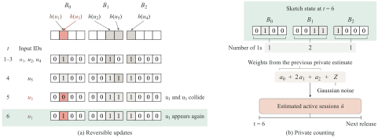

<div align="center">

<h1>✨ HFX</h1>

<p><strong>Accurate and Memory-Efficient Private Continual<br>
Cardinality Estimation for Active Sets</strong></p>

<p>Private active counting · Fixed memory · Identifier-only updates</p>

<p>
  <a href="#quick-start"></a>
  <a href="#quick-start"></a>
  <a href="#overview"></a>
  <a href="LICENSE"></a>
</p>

<p>
  <a href="#overview">Overview</a> ·
  <a href="#implementation">Implementation</a> ·
  <a href="#quick-start">Quick start</a> ·
  <a href="#examples">Examples</a> ·
  <a href="#parameters">Parameters</a> ·
  <a href="#datasets">Datasets</a>
</p>

</div>

---

<a id="overview"></a>

## ✨ HFX overview

**HFX tracks active sessions as they start and end, using a fixed-memory
reversible sketch and differentially private releases.** It consumes endpoint
identifiers without requiring start or end labels.

- 🔄 **Reversible updates.** A session's two endpoints toggle the same bit and
  cancel, allowing HFX to maintain current activity without per-session records.
- 🧠 **Fixed memory.** A nonuniform layout allocates the available bits before
  processing and remains fixed throughout the stream.
- 🎯 **Adaptive estimation.** Bounded column weights use the previous private
  estimate to reduce the effects of sketching error and privacy noise.
- 🔒 **Continual privacy.** Gaussian noise protects the full sequence of
  scheduled releases. The latest private estimate is held between releases.

<p align="center">
  
</p>

### Evaluation highlights

| Setting | Result reported in the paper |
| :--- | :--- |
| Four real streams, five privacy budgets, 512 KiB bitmap | **45.5–78.5% lower mean RMSE** than the central-DP adaptation of GMod |
| Ride, taxi, and network-flow streams, 32 KiB bitmap | Within **0.8–3.4%** of Exact-DP's mean RMSE, using **16.4–30.2%** of its complete state |
| One billion active sessions | **1.62% RMSD** with **32 KiB complete state** |

---

<a id="implementation"></a>

## 🛠 Implementation

The C++ core provides the sketch, adaptive decoder, and private releases.
Python commands build the programs, select layouts, and run experiments.

| Method | Command identifier | Implementation |
| :--- | :--- | :--- |
| **HFX** | `hfx` | Nonuniform layout and bounded adaptive weights — [core](src/lean_hfx.hpp) |
| **GMod** | `gmod_public` | Central-DP adaptation with publicly selected width — [reference](src/frozen/icde_audit.cpp) |
| **Half-Xor** | `hx_phi` | Bitmap-only φ estimator with 32 columns — [reference](src/frozen/icde_audit.cpp) |

The three methods share the input stream, release schedule, and privacy budget
in the [paired replay driver](benchmarks/replay.cpp).
The [public layout selector](tools/layout) uses declared parameters and a public
risk model. [Experiment configurations](configs/README.md) cover 154 settings.

---

<a id="quick-start"></a>

## 🚀 Quick start

**Requirements:** Python 3.10+ and a 64-bit GCC or Clang compiler with C++20
and `unsigned __int128` support. Layout selection uses NumPy, pandas, and SciPy.

```shell
git clone https://github.com/chengjin2643-lab/hfx_implementation.git
cd hfx_implementation
python -m pip install -r requirements.txt

python run_experiments.py build
python run_experiments.py check
python run_experiments.py demo
```

The example runs **21,000 endpoints, 200 releases, and a 32 KiB complete-state
budget**. It compares all three sketches and writes:

```text
results/
├── demo_summary.csv       # Per-trial accuracy and state size
├── demo_releases.csv      # Estimates at each release
└── demo_job.tsv           # Replay configuration
```

The checks verify endpoint cancellation, bounded weights, decoding,
update-path equivalence, memory budgets, and error metrics.

<details>
<summary><strong>Compiler setup</strong></summary>

The compiler must be available on `PATH`. Set `CXX` to choose a different
compiler. On Windows, MinGW-w64 GCC is supported and its directory can be
set in PowerShell:

```powershell
$env:HFX_MINGW_BIN = "C:\msys64\mingw64\bin"
python run_experiments.py build
```

Use `python run_experiments.py build --native` for machine-specific optimizations.

</details>

---

<a id="examples"></a>

## 🧪 Examples

### 1. One million active sessions

Compare three sketches on **3,000,000 endpoints**, with **200 releases**
and a **32 KiB complete-state budget**:

```shell
python run_experiments.py run --config configs/active32.json --trials 1 --output results/active32
```

To run HFX alone, add `--methods hfx`. Use `--trials 10` for ten paired trials.

### 2. Repeated activity

Exercise reactivated identifiers over **100,000 endpoints** at a **32 KiB
bitmap budget**:

```shell
python run_experiments.py run --config configs/paper.json --job reuse/reuse_t100000/m32/e1 --trials 1 --output results/repeated_activity
```

### 3. Select a layout

Choose a layout before processing from a **32 KiB complete-state budget**,
a **2,000,000-session capacity bound**, and **200 releases**:

```shell
python run_experiments.py select --memory-kib 32 --capacity 2000000 --releases 200 --mode full --objective controlled --output results/layout.json
```

The output supplies the `layout` entry of an experiment configuration.
`controlled` uses the minimax rule, while `real_accuracy` uses the
density-aware rule for real-stream experiments.

### 4. Replay an Azure VM stream

With the processed endpoint file at `data/azure_vm_endpoints_stable.bin`:

```shell
python run_experiments.py run --config configs/azure32.json --input data/azure_vm_endpoints_stable.bin --trials 1 --output results/azure32
```

This configuration uses **3,920,600 endpoints**, **393 releases**, and a
**32 KiB bitmap budget**. The [input-format guide](docs/experiments.md#endpoint-format)
describes the processed stream.

---

<a id="parameters"></a>

## ⚙️ Parameters

| Option | Command | Purpose |
| :--- | :--- | :--- |
| `--config` | `run` | JSON workload and layout configuration |
| `--job` | `run` | Named setting from `configs/paper.json` |
| `--methods` | `run` | Comma-separated `hfx,gmod_public,hx_phi` |
| `--trials`, `--seed` | `run` | Trial count and base seed |
| `--input` | `run` | Processed endpoint stream |
| `--memory-kib`, `--capacity` | `select` | Memory budget and public capacity bound |
| `--releases`, `--epsilon` | `select` | Release count and privacy budget |
| `--mode`, `--objective` | `select` | Memory setting and public selection rule |
| `--output` | `run`, `demo`, `select` | Output prefix or layout filename |

For `run`, workload and privacy parameters come from the JSON configuration.
All supplied configurations use `delta = 1e-6`.

**Memory settings:** `payload` limits the bitmap, while `full` limits complete
state including auxiliary arrays and decoder workspace. The replay checks
the limit for every method in `full` mode.

📖 [Experiment guide](docs/experiments.md) ·
[Configuration index](configs/README.md)

---

<a id="datasets"></a>

## 📊 Datasets

The evaluation covers synthetic workloads and four real activity streams.
The counts below refer to the **processed endpoint streams** used in the paper.

| Dataset | Activity | Endpoints | Official source |
| :--- | :--- | ---: | :--- |
| **CitiBike** | Active rides | 33,246,012 | [System data](https://citibikenyc.com/system-data) |
| **TLC-Yellow** | Active taxi trips | 29,447,920 | [TLC trip records](https://www.nyc.gov/site/tlc/about/tlc-trip-record-data.page) |
| **UGR16** | Active network flows | 5,408,868 | [UGR'16 dataset](https://nesg.ugr.es/nesg-ugr16/index.php) |
| **Azure VM** | Active virtual machines | 3,920,600 | [Azure Public Dataset V1](https://github.com/Azure/AzurePublicDataset/blob/master/AzurePublicDatasetV1.md) |

Each retained activity interval yields two occurrences of its identifier.
The sketches receive the identifiers, while interval labels supply evaluation
ground truth.

---

## 📄 License

Released under the [MIT License](LICENSE).
